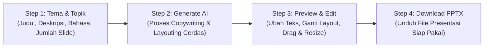

# 🚀 Master PPT AI — Generator PowerPoint Cerdas Berbasis AI

Web aplikasi cerdas untuk merancang dan memproduksi **Master PowerPoint (.pptx)** berstandar studio profesional dengan copywriting materi siap pakai, kurasi tipografi modern, kepatuhan data placeholder Canva Ipsum, dan pustaka **189 layout katalog asli** dari *Base Layout Presentasi (One Piece Design Studio)*.

**🌐 Production URL:** [https://master-ppt-ai.vercel.app](https://master-ppt-ai.vercel.app)  
**📦 Repository GitHub:** [https://github.com/hizkiaa13/master-ppt-ai](https://github.com/hizkiaa13/master-ppt-ai)

---

## 🌟 Fitur Utama & Pembaruan Terkini

### 1. 📐 Bank Layout Lengkap (189 Layout Asli Tanpa Distandarisasi)
Diadaptasi secara presisi dari katalog master 202 halaman *Base Layout Presentasi (One Piece Design Studio)*. Seluruh layout mempertahankan geometri persentase asli (0–100%), posisi badge, nomor kartu, dan rasio visualnya tanpa dipersempit menjadi 25 template:
- **Cover Depan (15 varian: `cover-p04` – `cover-p18`)**: Terpusat, editorial kiri, foto split, oval pill, badge perusahaan, majalah, dsb.
- **Daftar Isi / Agenda (4 varian: `agenda-p20` – `agenda-p23`)**: Grid 2 kolom 01–06, daftar vertikal 01–08, foto kanan + 5 topik, list panah bertingkat.
- **1 Poin (22 varian: `point1-p25` – `point1-p46`)**: Huge statement, split kiri, kolase foto, banner horizontal, pill badge, callout fakta, number highlight, dsb.
- **2 Poin (40 varian: `point2-p48` – `point2-p87`)**: Kolom A/B, baris horizontal 01/02, perbandingan versus, kartu gambar ganda, circular mask, dsb.
- **3 Poin (40 varian: `point3-p89` – `point3-p128`)**: 3 kolom bernomor, 3 kartu ikon, baris panah, timeline 3 titik, kartu gambar, dsb.
- **4 Poin (15 varian: `point4-p130` – `point4-p144`)**: Grid 2x2, 4 baris horizontal, roadmap Step 1–4, kuadran bernomor, diamond layout, dsb.
- **5 Poin (9 varian: `point5-p146` – `point5-p154`)**: Susunan 3 atas + 2 bawah, step box horizontal, timeline 01–05, list A–E, dsb.
- **6 Poin (6 varian: `point6-p156` – `point6-p161`)**: Grid 3x2, 2 kolom x 3 baris panah, pill kartu, hexagonal grid, dsb.
- **Chart & Data (9 varian: `chart-p163` – `chart-p171`)**: Bar chart split, line chart, pie chart 20%, demografi pria/wanita, 3 cincin donat persentase 67%, dsb.
- **Testimoni (6 varian: `testi-p173` – `testi-p178`)**: 3 kartu avatar + rating, 3 lingkaran, 3 rounded bottom, kutipan visi besar, foto + kutipan split, dsb.
- **Cover Belakang (23 varian: `closing-p180` – `closing-p202`)**: Thank You sentral, statement + kontak, oval Thank You, icon grid kontak, social pills, minimal goodbye, dsb.
- **Template Legacy (25 varian)**: Tetap didukung penuh sebagai alias untuk kompatibilitas draft sebelumnya.

### 2. 🖤 Desain Base Master (Hitam & Putih / Black & White Studio Concept)
- **Latar Belakang**: Putih bersih (`#FFFFFF`) di seluruh slide untuk menjaga kejernihan visual presentasi eksekutif.
- **Tipografi Utama (Heading)**: Hitam pekat (`#000000` / `#111827`) dengan bobot tebal dan kontras tinggi.
- **Tipografi Sekunder (Body/Content)**: Abu-abu gelap elegan (`#1F2937` / `#374151`).
- **Garis Aksen & Kartu**: Garis minimalis hitam pekat (`#000000`) dan border kartu netral (`#E5E7EB`).
- **Bebas Warna Acak**: Menghilangkan warna-warna pastel/campuran yang tidak sesuai standar korporat.

### 3. 📋 Kepatuhan Data Placeholder (Canva Ipsum Toolkit)
Seluruh materi demonstrasi, nama, kontak, dan alamat terintegrasi dengan toolkit resmi 18 halaman (*Copy of Toolkit Teks-Teks Placeholder Canva Ipsum*):
- **Alamat Indonesia**: Wajib menggunakan `Jl. Mangga Muda 17A, Cilandak, Jakarta Selatan 12310`.
- **Alamat Internasional**: Wajib menggunakan `123 Anywhere St., Any City`.
- **Kontak & Media**: Telepon `62-819-9977-3020` / `123-456-7890`, email `halo@situssupercanggih.co.id` / `hello@reallygreatsite.com`, website `www.situssupercanggih.co.id` / `www.reallygreatsite.com`.
- **Modal Sisipkan Placeholder**: Tombol modal *"📋 Sisipkan Placeholder"* pada toolbar editor memudahkan penyisipan nama orang, institusi, kontak, dan alamat resmi ke slide secara instan.
- **Auto-Sanitizer Backend**: Otomatis mengganti nama/alamat fiktif liar dengan entitas resmi Canva Ipsum.

### 4. 🎯 Relevansi Konten Ketat & Copywriting Siap Pakai
- **Bebas Kalimat Template**: Melarang keras kalimat generik seperti *"Poin strategi X untuk implementasi berkelanjutan"*.
- **Substansi Nyata**: Setiap poin berformat `[Nama Subtopik]: [Penjelasan konkret 1-2 kalimat informatif mengenai mekanisme/manfaatnya]`.
- **Validasi Relevansi Dwibahasa**: Evaluasi keterkaitan judul dengan materi slide dengan kamus padanan lintas bahasa (ID ↔ EN). Jika relevansi rendah, sistem melakukan auto-retry terarah atau fallback cerdas.

### 5. 🌐 Dukungan Penuh Multi-Bahasa (🇮🇩 ID & 🇬🇧 EN)
- **Pilihan Bahasa Fleksibel**: Tombol switcher *🇮🇩 Bahasa Indonesia* dan *🇬🇧 English* pada form awal generator.
- **AI Prompt Khusus Bahasa Inggris**: Jika bahasa Inggris dipilih, instruksi prompt, aturan anti-drift, dan contoh *few-shot JSON* otomatis menggunakan 100% Bahasa Inggris murni.
- **Renderer UI Dwibahasa**: Subjudul bawaan, info presenter, label kartu testimoni, chart, dan pesan penutup otomatis menyesuaikan bahasa yang dipilih.

### 6. 🛠️ Preview & Editor Slide Interaktif
- **Kanvas Slide Berasio 16:9**: Representasi akurat sesuai output PowerPoint modern.
- **Drag & Resize Bebas**: Didukung `react-rnd` dengan fitur *Snap to Grid* (grid 10px / 20px) dan panduan perataan (*Alignment Guidelines*).
- **Text Formatting Toolbar**: Kontrol tebal (bold), miring (italic), garis bawah (underline), perataan teks (kiri, tengah, kanan), dan ukuran font.
- **Dropdown Layout Dinamis**: Akses cepat ke seluruh 189 layout yang dikelompokkan rapi per kategori (Cover, Agenda, 1–6 Poin, Chart, Testimoni, Penutup).
- **Sistem Draft & Auto-Save**: Otomatis tersimpan secara periodik, shortcut `Ctrl+S` / `Cmd+S`, serta perlindungan *beforeunload*.

### 7. 📥 Ekspor PPTX Native (PptxGenJS v4)
- Menghasilkan file `.pptx` beresolusi 16:9 yang siap dipresentasikan di Microsoft PowerPoint, Google Slides, maupun Apple Keynote.
- Mendukung ekspor langsung dari browser (client-side) maupun backend API dengan styling dan positioning presisi.

---

## 🏗️ Alur Kerja Pembuatan (4 Langkah)



---

## 💻 Tech Stack

| Layer | Teknologi | Deskripsi |
|---|---|---|
| **Frontend** | React 19 + Vite 6 | Framework SPA modern, cepat, dan reaktif |
| **Styling** | Tailwind CSS 3 | Sistem styling utility-first dengan kontras tinggi |
| **Interaktivitas Canvas** | react-rnd | Drag, move, dan resize elemen slide secara visual |
| **Ikonografi** | Lucide React | Ikon modern, tajam, dan konsisten |
| **Backend** | Node.js (v20+) + Express 5 | RESTful API modular dan terstruktur |
| **AI Engine** | Google Gemini API (gemini-2.0-flash / gemini-1.5-flash) | Penyusun materi presentasi dan copywriting cerdas |
| **Database** | Supabase (PostgreSQL) | Penyimpanan user, riwayat master, dan draft presentasi |
| **PPTX Generation** | PptxGenJS v4 | Library generator presentasi PPTX OpenXML berstandar industri |
| **Deployment** | Vercel Serverless | Platform hosting production untuk frontend dan serverless API |

---

## 📁 Struktur Direktori

```
master-ppt-ai/
├── backend/
│   ├── src/
│   │   ├── controllers/          # Controller API (aiController, pptxController, dsb.)
│   │   ├── prompts/              # Master prompt generator (Prompt ID & EN dwibahasa)
│   │   ├── routes/               # Routing Express (ai.js, pptx.js, auth.js, dsb.)
│   │   ├── services/             # Layanan AI (aiService) & database
│   │   └── utils/                # Bank data & logika pembantu
│   │       ├── layoutCatalog.js      # 189 Layout katalog lengkap dari PDF
│   │       ├── layoutSelector.js     # Engine pemilihan layout dinamis
│   │       ├── layoutTemplates.js    # Definisi template gabungan (214 layout)
│   │       ├── placeholderToolkit.js # Kamus lengkap Canva Ipsum (ID & EN)
│   │       ├── contentValidator.js   # Validator relevansi dwibahasa
│   │       └── textToolkit.js        # Pasangan font pairing terkurasi
│   ├── .env.example
│   └── package.json
├── frontend/
│   ├── src/
│   │   ├── components/           # Komponen UI (SlidePreview, Toolbar, Modal, dsb.)
│   │   ├── pages/                # Halaman utama (Generator, Dashboard, History, dsb.)
│   │   ├── services/             # Client API (ai.js, pptx.js, auth.js)
│   │   └── utils/                # Utilitas frontend
│   │       ├── layoutCatalog.js      # ES Module katalog 189 layout
│   │       ├── layoutRenderer.js     # Engine render layout ke placeholder
│   │       ├── aiMapper.js           # Mapper respons AI ke slide editor
│   │       ├── placeholderToolkit.js # Kamus placeholder Canva Ipsum (Client)
│   │       └── pptxGenerator.js      # Generator PPTX client-side
│   ├── vite.config.js
│   └── package.json
├── vercel.json                   # Konfigurasi deployment Vercel monorepo
└── README.md
```

---

## 🌐 Endpoint API Utama

| Metode | Endpoint | Deskripsi | Akses |
|---|---|---|---|
| `POST` | `/api/ai/generate` | Menghasilkan struktur slide, copywriting, dan rekomendasi layout AI | Publik (Rate-limited) |
| `POST` | `/api/pptx/generate` | Menyusun master deck PowerPoint dan menyimpan ke database | JWT |
| `GET` | `/api/pptx/history` | Mengambil daftar riwayat master presentasi pengguna | JWT |
| `POST` | `/api/pptx/finalize/:id` | Finalisasi dan produksi berkas PPTX siap unduh | JWT |
| `POST` | `/api/auth/register` | Pendaftaran akun baru | Publik |
| `POST` | `/api/auth/login` | Masuk dan memperoleh token JWT | Publik |
| `GET` | `/api/health` | Status kesehatan API backend | Publik |

---

## 🚀 Panduan Menjalankan Secara Lokal

### Prasyarat
- Node.js versi 20 ke atas
- NPM versi 10 ke atas
- API Key Google Gemini ([Google AI Studio](https://aistudio.google.com/))
- Akun Supabase (opsional jika menggunakan fitur auth & simpan cloud)

### 1. Kloning Repositori
```bash
git clone https://github.com/hizkiaa13/master-ppt-ai.git
cd master-ppt-ai
```

### 2. Konfigurasi Environment Variables
Salin contoh file `.env` di folder backend:
```bash
cp master-ppt-ai/backend/.env.example master-ppt-ai/backend/.env
```
Sesuaikan konfigurasi di `master-ppt-ai/backend/.env`:
```env
PORT=5000
NODE_ENV=development
GEMINI_API_KEY=AIzaSy...your_gemini_api_key_here
GEMINI_MODEL=gemini-2.0-flash
SUPABASE_URL=https://your-project.supabase.co
SUPABASE_SERVICE_ROLE_KEY=your_service_role_key
JWT_SECRET=your_jwt_secret_key_here
```

### 3. Instalasi Dependensi & Menjalankan
Jalankan dari direktori root proyek:
```bash
# Instalasi modul
npm install
cd master-ppt-ai/backend && npm install
cd ../frontend && npm install
cd ../../

# Jalankan backend dan frontend bersamaan
npm run dev
```

- **Frontend**: `http://localhost:5173`
- **Backend API**: `http://localhost:5000`

---

## 🚢 Panduan Deployment (Vercel)

Aplikasi telah dikonfigurasi untuk deployment seamless ke Vercel:
1. Pastikan seluruh environment variables telah diisi pada **Project Settings > Environment Variables** di Vercel:
   - `GEMINI_API_KEY`
   - `GEMINI_MODEL` (disarankan `gemini-2.0-flash`)
   - `SUPABASE_URL`
   - `SUPABASE_SERVICE_ROLE_KEY`
   - `JWT_SECRET`
   - `NODE_ENV=production`
2. Jalankan perintah deploy:
   ```bash
   npx vercel --prod --yes
   ```
3. Domain aktif: `https://master-ppt-ai.vercel.app`

---

## 📄 Lisensi
Hak Cipta © 2026 **Master PPT AI**. Seluruh hak cipta dilindungi undang-undang.  
Katalog layout didesain berbasis *Base Layout Presentasi by One Piece Design Studio*.  
Kamus teks demonstrasi dilindungi panduan *Placeholder Text Toolkit (Canva Ipsum)*.
