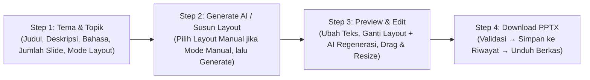

# 🚀 Master PPT AI — Generator PowerPoint Cerdas Berbasis AI

Web aplikasi cerdas untuk merancang dan memproduksi **Master PowerPoint (.pptx)** berstandar studio profesional dengan copywriting materi siap pakai, kurasi tipografi modern, kepatuhan data placeholder Canva Ipsum, pustaka **189 layout katalog asli** dari *Base Layout Presentasi (One Piece Design Studio)*, pilihan **Auto AI vs Manual Layout Mode**, **sistem riwayat master otomatis**, serta **regenerasi konten AI dinamis saat pergantian layout**.

**🌐 Production URL:** [https://master-ppt-ai.vercel.app](https://master-ppt-ai.vercel.app)  
**📦 Repository GitHub:** [https://github.com/hizkiaa13/master-ppt-ai](https://github.com/hizkiaa13/master-ppt-ai)

---

## 🌟 Fitur Utama & Pembaruan Terkini

### 1. 🎛️ Dua Mode Penyusunan Layout (Auto AI vs Susun Layout Sendiri)
Sebelum men-generate materi, pengguna dapat menentukan pendekatan pembuatan slide sesuai kebutuhan:
- **Auto Generate AI (Default)**: AI secara otomatis memilih kombinasi layout yang paling proporsional dari katalog 189 layout berdasarkan topik, konteks narasi, dan jumlah poin.
- **Susun Layout Sendiri (Manual Layout Mode)**: Pengguna memiliki kendali penuh untuk memilih tata letak per slide pada antarmuka visual. AI **menghormati 100%** pilihan tata letak pengguna dan fokus memproduksi copywriting substantif yang pas dengan jumlah poin layout tersebut.
  - **Slide 1 dikunci ke Cover Depan** — hanya layout cover yang tersedia.
  - **Slide terakhir dikunci ke Cover Belakang** — hanya layout closing yang tersedia.
  - **Slide tengah** — tersedia seluruh layout konten (1–6 Poin, Comparison, Roadmap Steps, Chart, Testimoni, Gambar & Teks, Daftar Isi/Agenda).

### 2. 🛡️ Sistem Validasi Slide & Anti-Dummy Text Ketat
Mencegah terjadinya slide kosong, dummy text bahasa asing, atau template generik pada output presentasi maupun berkas PPTX:
- **Deteksi Pola Dummy Otomatis**: Mendeteksi dan memblokir frasa seperti *"Lorem ipsum"*, *"Your Title Here"*, *"Write a short description"*, *"Add a main point"*, *"Poin strategi X untuk implementasi berkelanjutan"*, dsb.
- **Targeted Single-Slide Retry**: Jika terdapat slide yang kosong atau mengandung dummy text, sistem secara cerdas melakukan retry **hanya pada slide yang bermasalah** ke Google Gemini, tanpa merombak slide lain yang sudah valid.
- **Dynamic Substantive Fallback**: Jika setelah retry AI belum memberikan luaran sempurna, sistem otomatis menyusun poin materi konkret yang relevan langsung dengan judul dan deskripsi pengguna.
- **Peringatan Sebelum Ekspor**: Jika pengguna mencoba mengunduh deck yang memiliki slide kosong/dummy, sistem menampilkan modal peringatan dan menandai thumbnail slide terkait dengan badge peringatan merah.

### 3. 📜 Riwayat Master Otomatis (History Save on Download)
Setiap presentasi yang berhasil diunduh **otomatis tersimpan** ke Riwayat Master:
- **Alur Download & Simpan Terintegrasi**: Saat user mengklik "Download PPTX", sistem menyimpan data lengkap (judul, jumlah slide, bahasa, mode layout, data slide final, dan file PPTX base64) ke database **sebelum** memulai unduhan file.
- **Halaman Riwayat Master (`/history`)**: Menampilkan seluruh presentasi yang pernah dibuat dengan informasi judul, jumlah slide, bahasa output, tanggal pembuatan, tombol **Download Ulang**, dan tombol **Hapus**.
- **Dashboard (`/dashboard`)**: Menampilkan ringkasan 5 riwayat terbaru dengan tombol unduh cepat.
- **Navigasi Pasca-Download**: Setelah download berhasil, muncul tombol *"Lihat di Riwayat Master"* yang mengarahkan langsung ke halaman riwayat.
- **Endpoint API Lengkap**:
  - `POST /api/history/save` — Simpan deck master ke database.
  - `GET /api/history` — Daftar riwayat milik user (terbaru di atas).
  - `GET /api/history/:id` — Detail satu riwayat.
  - `DELETE /api/history/:id` — Hapus riwayat.
  - `GET /api/history/:id/download` — Unduh ulang file PPTX dari riwayat.

### 4. 🔄 Regenerasi Konten AI Dinamis saat Pergantian Layout
Saat pengguna mengganti layout slide di editor preview (misalnya dari 2 poin ke 5 poin), konten tambahan **dihasilkan secara cerdas oleh AI** — bukan diisi teks generik:
- **Deteksi Otomatis**: Sistem membandingkan jumlah poin layout lama vs baru.
- **Jika poin bertambah** → AI (`POST /api/ai/regenerate-slide`) dipanggil untuk menghasilkan poin baru yang **relevan dengan judul & tema slide**, mempertahankan poin lama yang sudah ada.
- **Jika poin berkurang** → Poin berlebih dipangkas dari akhir tanpa memanggil AI.
- **Jika poin sama** → Hanya visual layout yang berubah, tanpa regenerasi konten.
- **Loading Indicator**: Tampilan *"AI menyesuaikan konten..."* dengan spinner saat regenerasi berjalan.
- **Fallback Rule-Based**: Jika AI tidak tersedia atau gagal, sistem menggunakan poin substantif bawaan yang tetap relevan dengan konteks slide.
- **Prompt Khusus** (`regenerateSlidePrompt.js`): Instruksi terpisah yang memastikan poin baru 100% bebas dummy text dan selaras dengan topik presentasi, mendukung Bahasa Indonesia & English.

### 5. 📐 Bank Layout Lengkap (189 Layout Asli Tanpa Distandarisasi)
Diadaptasi secara presisi dari katalog master 202 halaman *Base Layout Presentasi (One Piece Design Studio)*. Seluruh layout mempertahankan geometri persentase asli (0–100%), posisi badge, nomor kartu, dan rasio visualnya:
- **Cover Depan (15 varian: `cover-p04` – `cover-p18`)**: Terpusat, editorial kiri, foto split, oval pill, badge perusahaan, majalah, dsb.
- **Daftar Isi / Agenda (4 varian: `agenda-p20` – `agenda-p23`)**: Grid 2 kolom 01–06, daftar vertikal 01–08, foto kanan + 5 topik, list panah bertingkat.
- **1 Poin (22 varian: `point1-p25` – `point1-p46`)**: Huge statement, split kiri, kolase foto, banner horizontal, pill badge, callout fakta, number highlight, dsb.
- **2 Poin (40 varian: `point2-p48` – `point2-p87`)**: Kolom A/B, baris horizontal 01/02, perbandingan versus, kartu gambar ganda, circular mask, dsb.
- **3 Poin (40 varian: `point3-p89` – `point3-p128`)**: 3 kolom bernomor, 3 kartu ikon, baris panah, timeline 3 titik, kartu gambar, dsb.
- **4 Poin (15 varian: `point4-p130` – `point4-p144`)**: Grid 2x2, 4 baris horizontal, roadmap Step 1–4, kuadran bernomor, diamond layout, dsb.
- **5 Poin (9 varian: `point5-p146` – `point5-p154`)**: Susunan 3 atas + 2 bawah, step box horizontal, timeline 01–05, list A–E, dsb.
- **6 Poin (6 varian: `point6-p156` – `point6-p161`)**: Grid 3x2, 2 kolom x 3 baris panah, pill kartu, hexagonal grid, dsb.
- **Chart & Data (9 varian: `chart-p163` – `chart-p171`)**: Bar chart split, line chart, pie chart 20%, demografi pria/wanita, 3 cincin donat persentase 67%, dsb.
- **Testimoni (6 varian: `testi-p173` – `testi-p178`)**: 3 kartu avatar + rating, 3 lingkaran, 3 rounded bottom, kutipan visi besar, foto + kutipan split, dsb.
- **Cover Belakang (23 varian: `closing-p180` – `closing-p202`)**: Thank You sentral, statement + kontak, oval Thank You, icon grid kontak, social pills, minimal goodbye, dsb.
- **Template Legacy (25 varian)**: Tetap didukung penuh sebagai alias untuk kompatibilitas draft sebelumnya.

### 6. 🖤 Desain Base Master (Hitam & Putih / Black & White Studio Concept)
- **Latar Belakang**: Putih bersih (`#FFFFFF`) di seluruh slide untuk menjaga kejernihan visual presentasi eksekutif.
- **Tipografi Utama (Heading)**: Hitam pekat (`#000000` / `#111827`) dengan bobot tebal dan kontras tinggi.
- **Tipografi Sekunder (Body/Content)**: Abu-abu gelap elegan (`#1F2937` / `#374151`).
- **Garis Aksen & Kartu**: Garis minimalis hitam pekat (`#000000`) dan border kartu netral (`#E5E7EB`).
- **Bebas Warna Acak**: Menghilangkan warna-warna pastel/campuran yang tidak sesuai standar korporat.

### 7. 📋 Kepatuhan Data Placeholder (Canva Ipsum Toolkit)
Seluruh materi demonstrasi, nama, kontak, dan alamat terintegrasi dengan toolkit resmi 18 halaman (*Copy of Toolkit Teks-Teks Placeholder Canva Ipsum*):
- **Alamat Indonesia**: Wajib menggunakan `Jl. Mangga Muda 17A, Cilandak, Jakarta Selatan 12310`.
- **Alamat Internasional**: Wajib menggunakan `123 Anywhere St., Any City`.
- **Kontak & Media**: Telepon `62-819-9977-3020` / `123-456-7890`, email `halo@situssupercanggih.co.id` / `hello@reallygreatsite.com`, website `www.situssupercanggih.co.id` / `www.reallygreatsite.com`.
- **Modal Sisipkan Placeholder**: Tombol modal *"📋 Sisipkan Placeholder"* pada toolbar editor memudahkan penyisipan nama orang, institusi, kontak, dan alamat resmi ke slide secara instan.
- **Auto-Sanitizer Backend**: Otomatis mengganti nama/alamat fiktif liar dengan entitas resmi Canva Ipsum.

### 8. 🎯 Copywriting Substantif & Relevansi Ketat
- **Substansi Nyata**: Setiap poin berformat `[Nama Subtopik]: [Penjelasan konkret 1-2 kalimat informatif mengenai mekanisme/manfaatnya]`.
- **Validasi Relevansi Dwibahasa**: Evaluasi keterkaitan judul dengan materi slide dengan kamus padanan lintas bahasa (ID ↔ EN). Jika relevansi rendah, sistem melakukan auto-retry terarah atau fallback cerdas.

### 9. 🌐 Dukungan Penuh Multi-Bahasa (🇮🇩 ID & 🇬🇧 EN)
- **Pilihan Bahasa Fleksibel**: Tombol switcher *🇮🇩 Bahasa Indonesia* dan *🇬🇧 English* pada form awal generator.
- **AI Prompt Khusus Bahasa Inggris**: Jika bahasa Inggris dipilih, instruksi prompt, aturan anti-drift, dan contoh *few-shot JSON* otomatis menggunakan 100% Bahasa Inggris murni.
- **Renderer UI Dwibahasa**: Subjudul bawaan, info presenter, label kartu testimoni, chart, dan pesan penutup otomatis menyesuaikan bahasa yang dipilih.

### 10. 🛠️ Preview & Editor Slide Interaktif
- **Kanvas Slide Berasio 16:9**: Representasi akurat sesuai output PowerPoint modern.
- **Drag & Resize Bebas**: Didukung `react-rnd` dengan fitur *Snap to Grid* (grid 10px / 20px) dan panduan perataan (*Alignment Guidelines*).
- **Text Formatting Toolbar**: Kontrol tebal (bold), miring (italic), garis bawah (underline), perataan teks (kiri, tengah, kanan), dan ukuran font.
- **Dropdown Layout Dinamis**: Akses cepat ke seluruh 189 layout yang dikelompokkan rapi per kategori, dengan loading indicator saat AI menyesuaikan konten.
- **Sistem Draft & Auto-Save**: Otomatis tersimpan secara periodik, shortcut `Ctrl+S` / `Cmd+S`, serta perlindungan *beforeunload*.

### 11. 📥 Ekspor PPTX Native (PptxGenJS v4)
- Menghasilkan file `.pptx` beresolusi 16:9 yang siap dipresentasikan di Microsoft PowerPoint, Google Slides, maupun Apple Keynote.
- Mendukung ekspor langsung dari browser (client-side) maupun backend API dengan styling dan positioning presisi.
- File PPTX otomatis tersimpan ke riwayat master untuk unduh ulang di kemudian hari.

### 12. 📂 Sistem Draft & Autosave
- **Auto-save Periodik**: Draft presentasi tersimpan otomatis saat user mengetik atau mengedit slide.
- **Shortcut `Ctrl+S` / `Cmd+S`**: Simpan draft secara manual kapan saja.
- **Resume Draft**: Lanjutkan pembuatan presentasi dari titik terakhir melalui halaman Dashboard.
- **Exit Confirmation**: Perlindungan `beforeunload` agar user tidak kehilangan progress saat meninggalkan halaman.

---

## 🏗️ Alur Kerja Pembuatan (4 Langkah)



---

## 💻 Tech Stack

| Layer | Teknologi | Deskripsi |
|---|---|---|
| **Frontend** | React 19 + Vite 6 | Framework SPA modern, cepat, dan reaktif |
| **Styling** | Tailwind CSS 3 | Sistem styling utility-first dengan kontras tinggi |
| **Interaktivitas Canvas** | react-rnd | Drag, move, dan resize elemen slide secara visual |
| **Ikonografi** | Lucide React | Ikon modern, tajam, dan konsisten |
| **Notifikasi** | react-hot-toast | Toast notification yang elegan dan responsif |
| **Backend** | Node.js (v20+) + Express 5 | RESTful API modular dan terstruktur |
| **AI Engine** | Google Gemini API (gemini-2.0-flash / gemini-1.5-flash) | Penyusun materi presentasi, copywriting cerdas, dan regenerasi konten per slide |
| **Database** | Supabase (PostgreSQL) | Penyimpanan user, riwayat master, draft presentasi, dan file PPTX |
| **PPTX Generation** | PptxGenJS v4 | Library generator presentasi PPTX OpenXML berstandar industri |
| **Deployment** | Vercel Serverless | Platform hosting production untuk frontend dan serverless API |

---

## 📁 Struktur Direktori

```
master-ppt-ai/
├── backend/
│   ├── src/
│   │   ├── controllers/
│   │   │   ├── aiController.js           # Controller AI generate & regenerate slide
│   │   │   ├── authController.js         # Controller autentikasi (register, login)
│   │   │   ├── draftController.js        # Controller CRUD draft presentasi
│   │   │   ├── historyController.js      # Controller riwayat master (save, list, delete, download)
│   │   │   ├── pptxController.js         # Controller generate, preview, update, finalize, download PPTX
│   │   │   ├── themeController.js        # Controller tema presentasi
│   │   │   └── userController.js         # Controller profil pengguna
│   │   ├── middleware/
│   │   │   ├── auth.js                   # Middleware JWT authentication
│   │   │   └── validation.js             # Middleware validasi input
│   │   ├── prompts/
│   │   │   ├── masterPrompt.js           # Master prompt generator (Auto AI & Manual Layout)
│   │   │   └── regenerateSlidePrompt.js  # Prompt khusus regenerasi poin saat layout berubah
│   │   ├── routes/
│   │   │   ├── ai.js                     # Route /api/ai (generate + regenerate-slide)
│   │   │   ├── auth.js                   # Route /api/auth (register, login)
│   │   │   ├── draft.js                  # Route /api/drafts (CRUD draft)
│   │   │   ├── history.js                # Route /api/history (save, list, detail, delete, download)
│   │   │   ├── pptx.js                   # Route /api/pptx (generate, preview, update, finalize, download)
│   │   │   ├── theme.js                  # Route /api/themes
│   │   │   └── user.js                   # Route /api/user (profil)
│   │   ├── services/
│   │   │   └── aiService.js              # Layanan AI: generateCopywriting, regenerateSlideContent, fallback
│   │   ├── utils/
│   │   │   ├── slideContentValidator.js  # Validasi slide & deteksi dummy text (30+ pola regex)
│   │   │   ├── layoutCatalog.js          # 189 Layout katalog lengkap dari PDF
│   │   │   ├── layoutSelector.js         # Engine pemilihan layout dinamis
│   │   │   ├── layoutTemplates.js        # Definisi template gabungan (214 layout)
│   │   │   ├── placeholderToolkit.js     # Kamus lengkap Canva Ipsum (ID & EN)
│   │   │   ├── contentValidator.js       # Validator relevansi dwibahasa
│   │   │   ├── textToolkit.js            # Pasangan font pairing terkurasi
│   │   │   ├── aiEngine.js              # Rule-based fallback engine
│   │   │   ├── colorDatabase.js         # Database warna
│   │   │   ├── fontDatabase.js          # Database font
│   │   │   └── layoutDatabase.js        # Database layout legacy
│   │   ├── config/
│   │   │   ├── supabase.js              # Konfigurasi Supabase client
│   │   │   ├── jwt.js                   # Konfigurasi JWT
│   │   │   └── database.js             # Konfigurasi database
│   │   └── app.js                       # Entry point Express server
│   ├── supabase-migration.sql           # Migrasi skema database lengkap
│   ├── .env.example
│   └── package.json
├── frontend/
│   ├── src/
│   │   ├── components/
│   │   │   ├── Generator/
│   │   │   │   ├── ThemeSelector.jsx          # Form input tema (judul, deskripsi, bahasa, mode layout)
│   │   │   │   ├── ManualLayoutSelector.jsx   # Pemilih layout manual per slide (cover/content/closing)
│   │   │   │   ├── SlidePreview.jsx           # Kanvas preview & editor slide + AI layout regeneration
│   │   │   │   ├── SlideCountSelector.jsx     # Pemilih jumlah slide
│   │   │   │   ├── TextFormattingToolbar.jsx  # Toolbar formatting teks (bold, italic, align)
│   │   │   │   ├── PlaceholderModal.jsx       # Modal sisipkan placeholder Canva Ipsum
│   │   │   │   ├── AlignmentGuidelines.jsx    # Panduan perataan visual
│   │   │   │   ├── ColorPicker.jsx            # Pemilih warna
│   │   │   │   └── ExitConfirmation.jsx       # Dialog konfirmasi keluar
│   │   │   ├── Dashboard/
│   │   │   │   └── DraftCard.jsx              # Kartu draft di dashboard
│   │   │   └── Layout/
│   │   │       ├── Navbar.jsx                 # Navigasi utama
│   │   │       └── Footer.jsx                 # Footer
│   │   ├── pages/
│   │   │   ├── Home.jsx                       # Landing page
│   │   │   ├── Login.jsx                      # Halaman login
│   │   │   ├── Register.jsx                   # Halaman registrasi
│   │   │   ├── Dashboard.jsx                  # Dashboard (riwayat + draft)
│   │   │   ├── Generator.jsx                  # Generator 4 langkah + download & save history
│   │   │   ├── History.jsx                    # Halaman riwayat master lengkap
│   │   │   └── Profile.jsx                    # Halaman profil pengguna
│   │   ├── hooks/
│   │   │   ├── useAuth.jsx                    # Hook autentikasi + AuthProvider
│   │   │   └── useDraft.js                    # Hook manajemen draft
│   │   ├── services/
│   │   │   ├── ai.js                          # Client API AI (generate + regenerateSlideContent)
│   │   │   ├── pptx.js                        # Client API PPTX (generate, download, saveHistory, deleteHistory, getHistory)
│   │   │   ├── auth.js                        # Client API autentikasi
│   │   │   ├── draft.js                       # Client API draft
│   │   │   └── api.js                         # Axios instance (base URL, interceptor, JWT header)
│   │   ├── utils/
│   │   │   ├── slideContentValidator.js       # Validasi sebelum ekspor PPTX (frontend)
│   │   │   ├── layoutCatalog.js               # ES Module katalog 189 layout
│   │   │   ├── layoutRenderer.js              # Engine render layout ke placeholder + applyLayoutToSlide
│   │   │   ├── aiMapper.js                    # Mapper respons AI ke slide editor
│   │   │   ├── placeholderToolkit.js          # Kamus placeholder Canva Ipsum (Client)
│   │   │   ├── pptxGenerator.js               # Generator PPTX client-side (PptxGenJS)
│   │   │   ├── autoResizeTextarea.js          # Utilitas auto-resize textarea
│   │   │   └── textToolkit.js                 # Font pairing toolkit (Client)
│   │   ├── App.jsx                            # Root App dengan routing & ProtectedRoute
│   │   ├── main.jsx                           # Entry point React
│   │   └── index.css                          # Global styles (Tailwind)
│   ├── index.html
│   ├── vite.config.js
│   ├── tailwind.config.js
│   ├── postcss.config.js
│   └── package.json
├── Base Layout Presentasi.pdf                 # Katalog sumber 202 halaman (189 layout)
├── Copy-of-Toolkit-Teks-Teks-Placeholder-Canva-Ipsum.pdf  # Toolkit Canva Ipsum (18 halaman)
├── .gitignore
└── README.md
```

---

## 🌐 Endpoint API Utama

### AI & Konten

| Metode | Endpoint | Deskripsi | Akses |
|---|---|---|---|
| `POST` | `/api/ai/generate` | Menghasilkan struktur slide, copywriting, dan rekomendasi layout AI (Auto & Manual Mode) | Publik (Rate-limited: 60 req/15 menit) |
| `POST` | `/api/ai/regenerate-slide` | Regenerasi poin konten satu slide saat layout berubah (AI + fallback rule-based) | Publik (Rate-limited: 60 req/15 menit) |

### PPTX & Slide

| Metode | Endpoint | Deskripsi | Akses |
|---|---|---|---|
| `POST` | `/api/pptx/generate` | Menyusun master deck PowerPoint dan menyimpan ke database | JWT |
| `GET` | `/api/pptx/preview/:masterId` | Mengambil preview slide dari master deck | JWT |
| `PUT` | `/api/pptx/slide/:masterId/:slideNumber` | Memperbarui konten satu slide | JWT |
| `PUT` | `/api/pptx/slides/:masterId` | Memperbarui seluruh slide sekaligus | JWT |
| `POST` | `/api/pptx/finalize/:masterId` | Finalisasi dan produksi berkas PPTX final | JWT |
| `GET` | `/api/pptx/download/:id` | Mengunduh file PPTX | JWT |
| `GET` | `/api/pptx/history` | Mengambil daftar riwayat master (alias legacy) | JWT |

### Riwayat Master

| Metode | Endpoint | Deskripsi | Akses |
|---|---|---|---|
| `POST` | `/api/history/save` | Menyimpan deck master final ke riwayat saat download | JWT |
| `GET` | `/api/history` | Mengambil daftar riwayat master milik pengguna | JWT |
| `GET` | `/api/history/:id` | Mengambil detail satu riwayat master | JWT |
| `DELETE` | `/api/history/:id` | Menghapus satu riwayat master | JWT |
| `GET` | `/api/history/:id/download` | Mengunduh ulang file PPTX dari riwayat | JWT |

### Draft

| Metode | Endpoint | Deskripsi | Akses |
|---|---|---|---|
| `POST` | `/api/drafts` | Membuat atau memperbarui draft presentasi | JWT |
| `GET` | `/api/drafts` | Mengambil daftar draft milik pengguna | JWT |
| `GET` | `/api/drafts/:id` | Mengambil detail satu draft | JWT |
| `DELETE` | `/api/drafts/:id` | Menghapus satu draft | JWT |

### Autentikasi & Pengguna

| Metode | Endpoint | Deskripsi | Akses |
|---|---|---|---|
| `POST` | `/api/auth/register` | Pendaftaran akun baru | Publik |
| `POST` | `/api/auth/login` | Masuk dan memperoleh token JWT | Publik |
| `GET` | `/api/user/profile` | Mengambil profil pengguna | JWT |
| `PUT` | `/api/user/profile` | Memperbarui profil pengguna | JWT |
| `PUT` | `/api/user/password` | Mengubah kata sandi | JWT |
| `GET` | `/api/health` | Status kesehatan API backend | Publik |

---

## 🗄️ Skema Database (Supabase / PostgreSQL)

### Tabel `ppt_users`
Menyimpan data akun pengguna.

### Tabel `themes`
Menyimpan konfigurasi tema (font, warna, layout template).

### Tabel `master_histories`
Menyimpan riwayat master presentasi yang telah diunduh:
- `id`, `user_id`, `theme_id`, `theme_name`, `title`, `slide_count`
- `output_language`, `layout_mode`, `layout_selections`
- `custom_fonts`, `custom_colors`, `custom_layouts`
- `slide_previews`, `edited_slides`, `final_data`
- `pptx_file_path`, `final_pptx_path`, `created_at`

### Tabel `drafts`
Menyimpan draft presentasi yang sedang dikerjakan:
- `id`, `user_id`, `title`, `description`, `status`
- `output_language`, `layout_mode`, `layout_selections`
- `form_data`, `slides_data`, `master_id`, `step`
- `created_at`, `updated_at`

### Tabel `slide_layouts`
Menyimpan layout per slide untuk setiap draft.

---

## 📊 Halaman Aplikasi

| Rute | Halaman | Akses | Deskripsi |
|---|---|---|---|
| `/` | Home | Publik | Landing page dengan fitur utama |
| `/login` | Login | Publik | Autentikasi masuk |
| `/register` | Register | Publik | Pendaftaran akun baru |
| `/dashboard` | Dashboard | JWT | Ringkasan riwayat, draft, statistik |
| `/generator` | Generator | JWT | Wizard 4 langkah pembuatan presentasi |
| `/history` | Riwayat Master | JWT | Daftar lengkap riwayat + download ulang + hapus |
| `/profile` | Profil | JWT | Pengaturan akun pengguna |

---

## 🚀 Panduan Menjalankan Secara Lokal

### Prasyarat
- Node.js versi 20 ke atas
- NPM versi 10 ke atas
- API Key Google Gemini ([Google AI Studio](https://aistudio.google.com/))
- Akun Supabase (opsional jika menggunakan fitur auth & simpan cloud)

### 1. Kloning Repositori
```bash
git clone https://github.com/hizkiaa13/master-ppt-ai.git
cd master-ppt-ai
```

### 2. Konfigurasi Environment Variables
Salin contoh file `.env` di folder backend:
```bash
cp master-ppt-ai/backend/.env.example master-ppt-ai/backend/.env
```
Sesuaikan konfigurasi di `master-ppt-ai/backend/.env`:
```env
PORT=5000
NODE_ENV=development
GEMINI_API_KEY=AIzaSy...your_gemini_api_key_here
GEMINI_MODEL=gemini-2.0-flash
SUPABASE_URL=https://your-project.supabase.co
SUPABASE_SERVICE_ROLE_KEY=your_service_role_key
JWT_SECRET=your_jwt_secret_key_here
```

### 3. Instalasi Dependensi & Menjalankan
Jalankan dari direktori root proyek:
```bash
# Instalasi modul
npm install
cd master-ppt-ai/backend && npm install
cd ../frontend && npm install
cd ../../

# Jalankan backend dan frontend bersamaan
npm run dev
```

- **Frontend**: `http://localhost:5173`
- **Backend API**: `http://localhost:5000`

---

## 🚢 Panduan Deployment (Vercel)

Aplikasi telah dikonfigurasi untuk deployment seamless ke Vercel:
1. Pastikan seluruh environment variables telah diisi pada **Project Settings > Environment Variables** di Vercel:
   - `GEMINI_API_KEY`
   - `GEMINI_MODEL` (disarankan `gemini-2.0-flash`)
   - `SUPABASE_URL`
   - `SUPABASE_SERVICE_ROLE_KEY`
   - `JWT_SECRET`
   - `NODE_ENV=production`
2. Jalankan perintah deploy:
   ```bash
   npx vercel --prod --yes
   ```
3. Domain aktif: `https://master-ppt-ai.vercel.app`

---

## 📝 Changelog Ringkas

| Commit | Deskripsi |
|---|---|
| `c58a515` | ✅ Riwayat master otomatis saat download + AI regenerasi konten saat layout berubah |
| `c8d5cac` | ✅ Full 189 layout pada mode manual dengan isolasi cover & closing |
| `0285ab1` | ✅ Validasi anti-dummy text + mode Auto AI vs Manual Layout |
| `1f9bb76` | 📝 Pembaruan README lengkap |
| `ffbea2e` | 🌐 Perbaikan output 100% English saat bahasa Inggris dipilih |
| `63d7cc0` | 📐 Katalog lengkap 189 layout dari PDF tanpa standarisasi |
| `1c951d6` | 📋 Toolkit Canva Ipsum + modal sisipkan placeholder |
| `75c5392` | 🔧 Perbaikan konten AI aktual ke placeholder slide |
| `b9e0870` | 🎯 Enforcement kontras font tinggi + relevansi copywriting 100% |
| `a096563` | 🔧 Perbaikan kritis kontras warna font |

---

## 📄 Lisensi
Hak Cipta © 2026 **Master PPT AI**. Seluruh hak cipta dilindungi undang-undang.  
Katalog layout didesain berbasis *Base Layout Presentasi by One Piece Design Studio*.  
Kamus teks demonstrasi dilindungi panduan *Placeholder Text Toolkit (Canva Ipsum)*.
